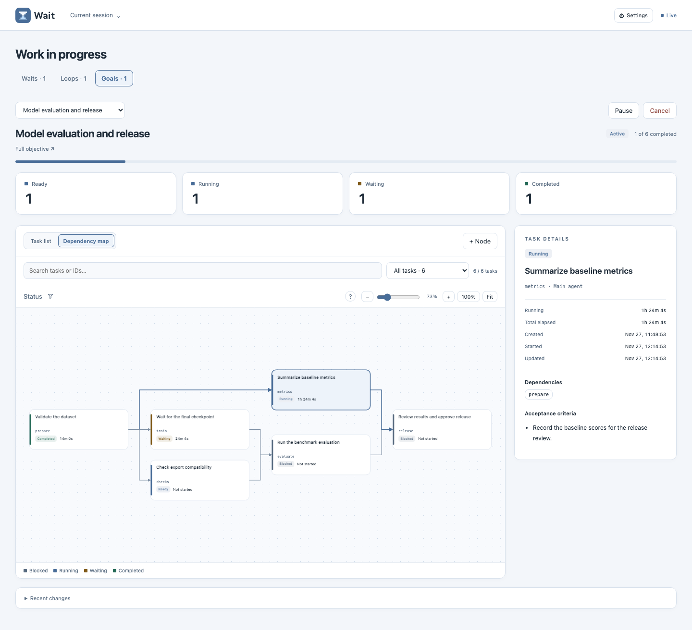
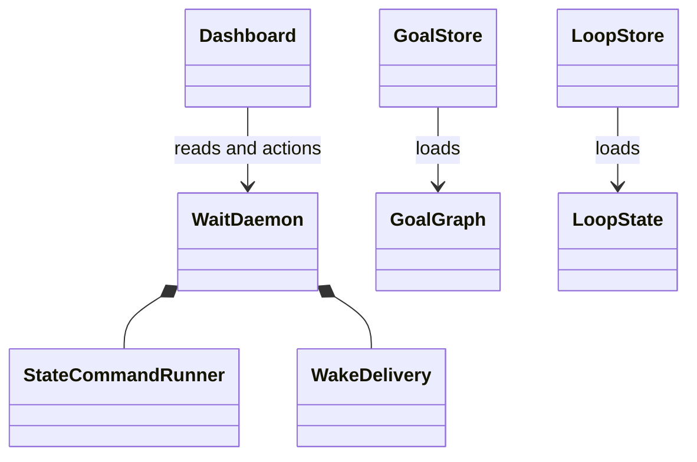

<p align="center">
  
</p>

<p align="center">
  <strong>Wait for events. Resume with context.</strong><br>
  External waits, bounded loops, and durable task graphs for agents.
</p>

<p align="center">
  <a href="#install">Install</a> · <a href="#usage">Usage</a> · <a href="docs/dashboard.md">Dashboard docs</a> · <a href="README.zh-CN.md">简体中文</a>
</p>



<p align="center"><sub>Example tasks · English interface · Light theme</sub></p>

## Install

Requires Python 3.11 or newer with pip. Install on the host that runs `waitd`.

### From skills.sh

This install command requires Node.js.

```sh
npx skills add wenxueru/wait-skill --skill wait
```

Open a new session and ask the agent to set up Wait, or follow [Python setup](#python-setup) yourself.

### From GitHub

```sh
git clone https://github.com/wenxueru/wait-skill.git /path/to/wait-skill
python /path/to/wait-skill/src/install_skill.py
```

- The installer downloads pinned Python libraries into this skill only. Run Wait with the same Python used to install it.
- Default destination: `${CODEX_HOME:-~/.codex}/skills/wait`. For another client, pass `--destination /path/to/client/skills/wait`.
- Installation replaces packaged files, removes old nested skills and matching `wait-goal` / `wait-loop` symlinks, and keeps no backups. Unrelated sibling directories remain.
- Reload the client after installing. Let an older daemon's watches finish before [stopping it to switch versions](docs/waitd.md#service-lifecycle).

### Python setup

After installing through a skill manager or plugin directory, use Python 3.11 or newer on macOS or Linux. Point `WAIT_SKILL_DIR` at the installed directory that contains `SKILL.md`.

```sh
WAIT_SKILL_DIR=/path/to/installed/wait
python3 -m venv "$HOME/.cache/wait-skill/venv"
"$HOME/.cache/wait-skill/venv/bin/python" -m pip install -r "$WAIT_SKILL_DIR/src/requirements.txt"
```

Run the packaged `src/waitctl.py` with that interpreter. For automatic wake delivery, check the session's [Codex app-server connection](docs/clients.md#codex).

## Usage

| Mode | Use it for |
| --- | --- |
| [Wait](docs/wait.md) | One external event |
| [Loop](docs/loop.md) | A repeated check or task with a time limit |
| [Goal](docs/goal.md) | Dependent tasks with acceptance and resumable progress |

```text
$wait Wait for deployment/api to become Ready; stop if it becomes Failed.

$wait loop Every 10 minutes for 2 hours: inspect deployment/api and report changes.

$wait goal Ship the API. Split implementation and tests; finish after tests and health checks pass.
```

While the agent is idle, local `waitd` checks state, saves results, and delivers events. The owning agent then verifies the current state and continues.

## Dashboard

Use the Python interpreter and skill path from your installation. For the default GitHub installation, run this in the owning session.

```sh
python ~/.codex/skills/wait/src/waitctl.py dashboard --session "$CODEX_THREAD_ID"
```

- Open the task that needs attention from the session summary. Completed and cancelled tasks are in **History**.
- Filter by status, sort by duration, and inspect dependencies or loop history.
- Switch language or theme in **Settings**. The default is English and light mode.

Task commands also return a scoped `dashboard_url`. See [dashboard docs](docs/dashboard.md) for controls and remote access.

## Event delivery

- **Codex** wakes the original app-server session. A saved event waits for the same endpoint to return if it goes offline. See [Codex delivery](docs/clients.md#delivery-and-recovery).
- **Claude Code** uses a native background `follow` task in the owning conversation. See [Claude Code setup](docs/clients.md#claude-code).

Use read-only waiting programs with a deadline. Store credentials in the environment. The owning agent verifies the result and current state before continuing.

## Development

`aiohttp` serves the dashboard and `websockets` carries Codex RPC. The browser uses [bundled modules](assets/vendor/README.md). Frontend development requires Node.js.

| Location | Responsibility |
| --- | --- |
| `src/` entry points | CLI, installer, waiting-program API, and shared subprocess worker |
| `src/wait/tasks/` | Goal and Loop state engines |
| `src/wait/service/` | Watcher supervision, wake delivery, and dashboard HTTP service |
| `src/wait/clients/` | Client delivery adapters |
| Shared `src/wait/` modules | Runtime, service identity, and loopback address policy |
| `src/wait/dashboard/` | Shared task views, pure task/navigation models, appearance, interaction controllers, and bundled graph layout |
| `agents/openai.yaml` | Skill name, icons, brand color, and default prompt |
| `tests/` | Tests mirror source layers; `integration/` covers processes and documentation |

```text
src/wait/
  dashboard/
    app.mjs          View composition
    models/          State, relationships, links
    controls/        Filters, sessions, viewport, help
    graph/           Dagre layout
    styles.css       Shared appearance
assets/
  brand/             SVG marks
  vendor/            Bundled dependencies
```

`WaitDaemon` supervises watchers and saves their state. `WakeDelivery` handles send attempts, retry times, and receipts. The dashboard uses the service for reads and actions. Goal state types live in `tasks/schema.py`.



Install the Python dependencies in a development environment, then run the checks from the repository root:

```sh
python -m pip install -r src/requirements.txt
python -m unittest discover -s tests -t . -v
npm test
python /path/to/skill-creator/scripts/quick_validate.py .
```

### Desktop plugin package

Run `python -m scripts.package_plugin` from the repository root to build the desktop plugin ZIP in `dist/`.

## Related work

`$wait goal` is an independent implementation and copies no code from these projects. Its direct influences are:

- [MACU](https://arxiv.org/abs/2606.01533) ([code](https://github.com/kohjingyu/multi-agent-computer-use)): centralized scheduling, dynamic DAGs, bounded parallel dispatch, and durable graph history. `$wait goal` adds cross-turn suspension and external event wake-ups.
- [DynTaskMAS](https://arxiv.org/abs/2503.07675): dispatching dependency-ready tasks and passing dependency-scoped context. `$wait goal` routes all communication through the root agent.
- [Atomic Task Graph](https://arxiv.org/abs/2607.01942): explicit node input/artifact contracts, append-only events, and retained retry attempts.

## License

MIT. See [bundled dependency notices](assets/vendor/README.md).
