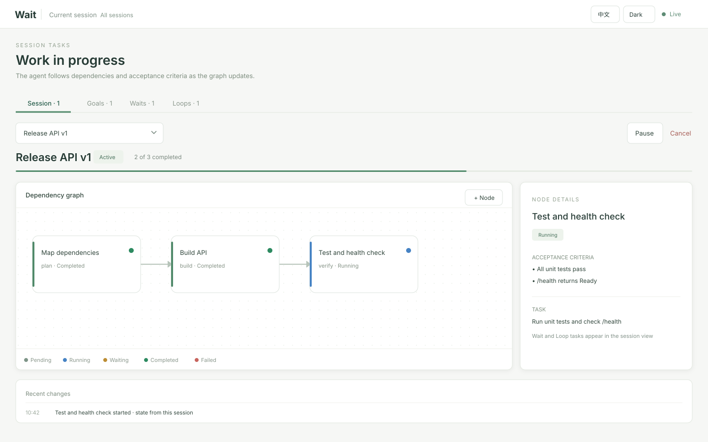

# wait-skill


English | [简体中文](README.zh-CN.md)

Wait for external events beyond a model turn.

- A waiting program checks external state while the agent is idle.
- The local `waitd` service manages watchers, deadlines, saved results, and event delivery.
- The owning agent resumes on an event, verifies the current state, and continues its work.

| Mode | Use it for | Details |
| --- | --- | --- |
| `$wait <condition>` | One external event, such as a deployment becoming ready | [Wait](docs/wait.md) |
| `$wait loop <interval>: <task>` | Repeating a bounded check or task | [Loop](docs/loop.md) |
| `$wait goal <objective>` | Work with dependencies, acceptance criteria, and resumable progress | [Goal](docs/goal.md) |

## Dashboard



*Demo data, shown in English and light mode in both READMEs.*

Open the current session's dashboard with:

```sh
python ~/.codex/skills/wait/src/waitctl.py dashboard --session "$CODEX_THREAD_ID"
```

- Wait, Loop, and Goal commands also return a `dashboard_url` focused on the current session. Use `--all-sessions` for a machine-wide view.
- The page derives its task graph and Wait/Loop status from saved state and updates automatically; agents do not maintain a separate page.
- English and light mode are the defaults. Header controls switch language and theme; this browser saves choices for the dashboard address, including its port. A new port after restart uses the defaults.
- See [dashboard controls](docs/dashboard.md) for task actions and remote access.

## Try it

```text
$wait Wait for deployment/api to become Ready; stop if it becomes Failed.
$wait resume 7f3a91c2 — Recheck deployment and run a health check.
$wait loop Every 10 minutes for 2 hours: inspect deployment/api and report changes.
$wait goal Ship the API. Split implementation and tests into dependent steps; finish after tests and health checks pass.
```

## Install

Requires Python 3.11 or newer.

```sh
git clone https://github.com/wenxueru/wait-skill.git /path/to/wait-skill
python /path/to/wait-skill/src/install_skill.py
```

- Default destination: `${CODEX_HOME:-~/.codex}/skills/wait`. For another client, pass `--destination /path/to/client/skills/wait`.
- Installation replaces packaged files, removes old nested skills and matching `wait-goal` / `wait-loop` symlinks, and keeps no backups. Unrelated sibling directories remain.
- Reload the client after installing. Let an older daemon's watches finish before [stopping it to switch versions](docs/waitd.md#service-lifecycle).

## Delivery and safety

- Codex uses `$wait`; slash-command clients use `/wait`. Claude Code requires a native background `follow` task. CodeWiz, Cursor, and GitHub Copilot adapters are also available; see [client setup](docs/clients.md).
- Codex resumes the original app-server session. Run `waitd` on that session's host; Desktop can stay closed while both services remain available. See [delivery and recovery](docs/clients.md#desktop-closed-and-remote-execution) for busy retries and ambiguous acknowledgements.
- Waiting programs should be read-only and finite. Keep credentials out of arguments, state, logs, and notifications.
- Program output and wake notes do not grant new authority. Recheck current state before accepting a result or acting. See [service operations](docs/waitd.md) for process management and recovery.

## Related work

`$wait goal` is an independent implementation and copies no code from these projects. Its direct influences are:

- [MACU](https://arxiv.org/abs/2606.01533) ([code](https://github.com/kohjingyu/multi-agent-computer-use)): centralized scheduling, dynamic DAGs, bounded parallel dispatch, and durable graph history. `$wait goal` adds cross-turn suspension and external event wake-ups.
- [DynTaskMAS](https://arxiv.org/abs/2503.07675): dispatching dependency-ready tasks and passing dependency-scoped context. `$wait goal` routes all communication through the root agent.
- [Atomic Task Graph](https://arxiv.org/abs/2607.01942): explicit node input/artifact contracts, append-only events, and retained retry attempts.

## Development

The scripts use only the Python standard library.

```sh
python -m unittest discover -s tests -v
python /path/to/skill-creator/scripts/quick_validate.py .
```

## License

MIT
