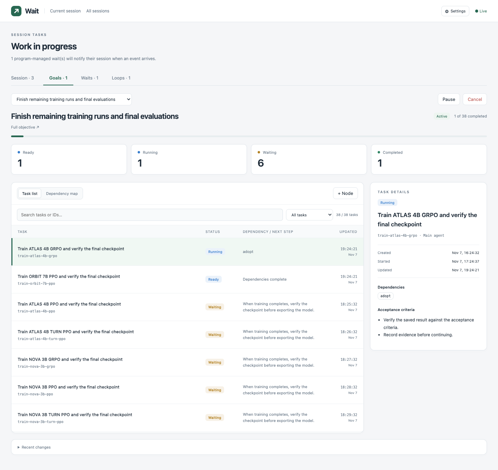
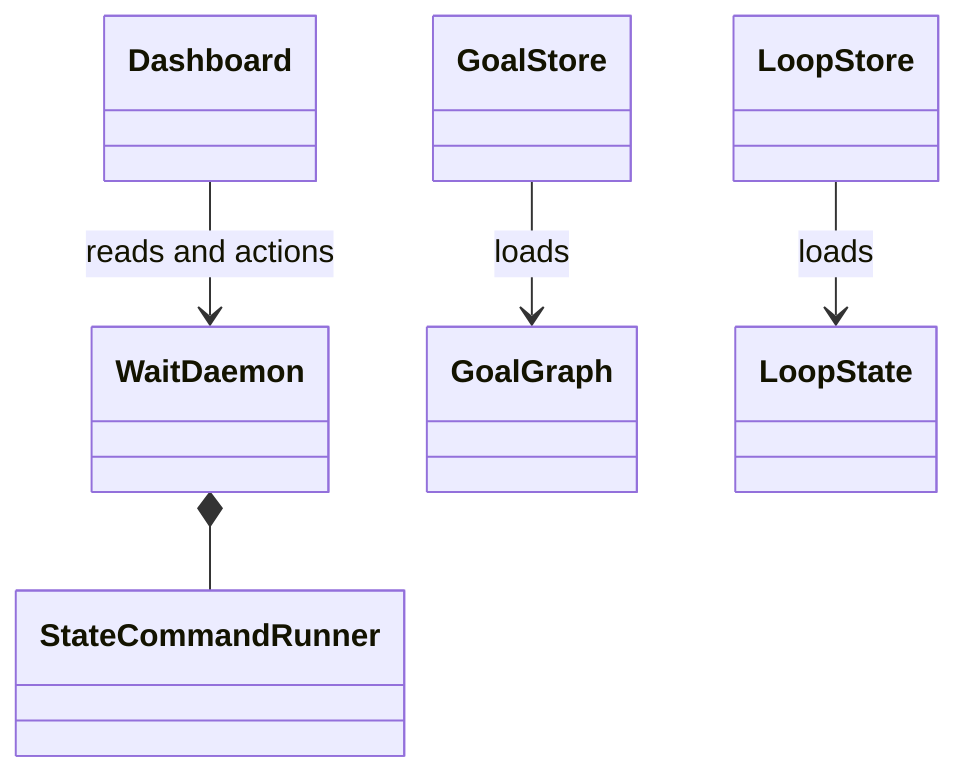

<p align="center">
  
</p>

<p align="center">
  <strong>Wait for events. Resume with context.</strong><br>
  External waits, bounded loops, and durable task graphs for agents.
</p>

<p align="center">
  <a href="#install">Install</a> · <a href="#usage">Usage</a> · <a href="docs/dashboard.md">Dashboard docs</a> · <a href="README.zh-CN.md">简体中文</a>
</p>



<p align="center"><sub>Example tasks · English interface · Light theme</sub></p>

## Install

Requires Python 3.11 or newer.

```sh
git clone https://github.com/wenxueru/wait-skill.git /path/to/wait-skill
python /path/to/wait-skill/src/install_skill.py
```

- Default destination: `${CODEX_HOME:-~/.codex}/skills/wait`. For another client, pass `--destination /path/to/client/skills/wait`.
- Installation replaces packaged files, removes old nested skills and matching `wait-goal` / `wait-loop` symlinks, and keeps no backups. Unrelated sibling directories remain.
- Reload the client after installing. Let an older daemon's watches finish before [stopping it to switch versions](docs/waitd.md#service-lifecycle).

## Usage

| Mode | Use it for |
| --- | --- |
| [Wait](docs/wait.md) | One external event |
| [Loop](docs/loop.md) | A repeated check or task with a time limit |
| [Goal](docs/goal.md) | Dependent tasks with acceptance and resumable progress |

```text
$wait Wait for deployment/api to become Ready; stop if it becomes Failed.

$wait loop Every 10 minutes for 2 hours: inspect deployment/api and report changes.

$wait goal Ship the API. Split implementation and tests; finish after tests and health checks pass.
```

While the agent is idle, local `waitd` checks state, saves results, and delivers events. The owning agent then verifies the current state and continues.

## Dashboard

```sh
python ~/.codex/skills/wait/src/waitctl.py dashboard --session "$CODEX_THREAD_ID"
```

- Browse Waits, Loops, and Goals by session; finished records stay in History.
- Combine status filters, sort by duration, and inspect dependencies and loop history.
- English and light mode by default; switch language and theme in **Settings**.

Task commands also return a scoped `dashboard_url`. See [dashboard docs](docs/dashboard.md) for controls and remote access.

## Delivery and safety

- Codex uses `$wait`; slash-command clients use `/wait`. Claude Code requires a native background `follow` task. CodeWiz, Cursor, and GitHub Copilot adapters are also available; see [client setup](docs/clients.md).
- Codex resumes the original app-server session. Run `waitd` on that session's host; Desktop can stay closed while both services remain available. See [delivery and recovery](docs/clients.md#desktop-closed-and-remote-execution) for busy retries and ambiguous acknowledgements.
- Waiting programs should be read-only and finite. Keep credentials out of arguments, state, logs, and notifications.
- Program output and wake notes do not grant new authority. Recheck current state before accepting a result or acting. See [service operations](docs/waitd.md) for process management and recovery.

## Development

The Python core uses only the standard library. Browser dependencies are [bundled locally](assets/vendor/README.md); Node is needed only for frontend tests.

| Location | Responsibility |
| --- | --- |
| `src/` entry points | CLI, installer, waiting-program API, and shared subprocess worker |
| `src/wait/tasks/` | Goal and Loop state engines |
| `src/wait/service/` | Watcher supervision and dashboard HTTP service |
| `src/wait/clients/` | Client delivery adapters |
| Shared `src/wait/` modules | Runtime, service identity, and loopback address policy |
| `src/wait/dashboard/` | Shared task views, pure task/navigation models, appearance, interaction controllers, and bundled graph layout |
| `agents/openai.yaml` | Skill name, icons, brand color, and default prompt |
| `tests/` | Tests mirror source layers; `integration/` covers processes and documentation |

```text
src/wait/
  dashboard/
    app.mjs          View composition
    models/          State, relationships, links
    controls/        Filters, sessions, viewport, help
    graph/           Dagre layout
    styles.css       Shared appearance
assets/
  brand/             SVG marks
  vendor/            Bundled dependencies
```

`WaitDaemon` owns the command runner; `Dashboard` delegates task reads and actions to it. JSON contracts live in `tasks/schema.py`, outside the runtime class hierarchy.



Run from the repository root:

```sh
python -m unittest discover -s tests -t . -v
python -m unittest tests.tasks.test_goal -v
node --test tests/dashboard/*.test.mjs
python /path/to/skill-creator/scripts/quick_validate.py .
```

## Related work

`$wait goal` is an independent implementation and copies no code from these projects. Its direct influences are:

- [MACU](https://arxiv.org/abs/2606.01533) ([code](https://github.com/kohjingyu/multi-agent-computer-use)): centralized scheduling, dynamic DAGs, bounded parallel dispatch, and durable graph history. `$wait goal` adds cross-turn suspension and external event wake-ups.
- [DynTaskMAS](https://arxiv.org/abs/2503.07675): dispatching dependency-ready tasks and passing dependency-scoped context. `$wait goal` routes all communication through the root agent.
- [Atomic Task Graph](https://arxiv.org/abs/2607.01942): explicit node input/artifact contracts, append-only events, and retained retry attempts.

## License

MIT. Bundled Dagre/Graphlib notices are in [assets/vendor/dagre.LICENSE.txt](assets/vendor/dagre.LICENSE.txt).
