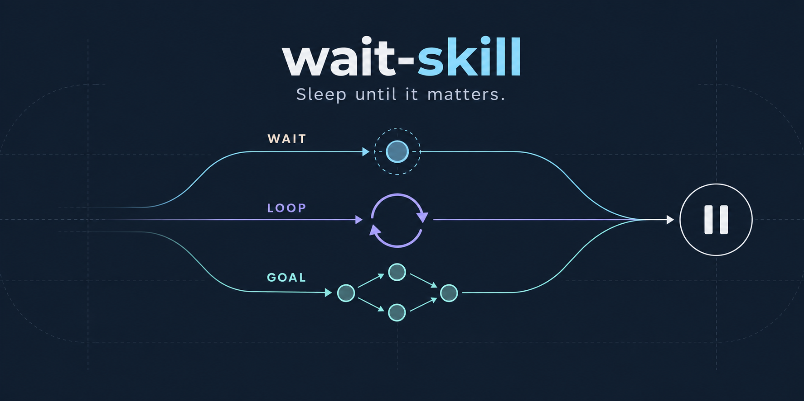

# wait-skill



[English](README.md) | 简体中文

在模型轮次之外等待外部事件。

- 等待程序检查外部状态，Agent 无需持续运行。
- 本地 `waitd` 服务管理 watcher、截止时间、保存的结果和事件投递。
- 事件发生后唤醒所属 Agent，由它复查当前状态，再继续工作。

| 模式 | 适用场景 | 说明 |
| --- | --- | --- |
| `$wait <条件>` | 等待一次外部事件，例如部署就绪 | [Wait](docs/wait.zh-CN.md) |
| `$wait loop <间隔>: <任务>` | 在有限时长内重复检查或执行任务 | [Loop](docs/loop.zh-CN.md) |
| `$wait goal <目标>` | 按依赖和验收条件推进、恢复任务图 | [Goal](docs/goal.zh-CN.md) |

## 看板


*使用示例任务的看板截图，默认英文、浅色主题。*

打开当前会话的看板：

```sh
python ~/.codex/skills/wait/src/waitctl.py dashboard --session "$CODEX_THREAD_ID"
```

- Wait、Loop 和 Goal 命令返回所属会话的 `dashboard_url`；需要本机总览时使用 `--all-sessions`。
- 任务列表展示状态和已有的更新时间，依赖图自动减少交叉；页面随任务状态更新，Agent 只需维护任务。
- 默认英文、浅色主题，可在「设置」中选择中文和深色主题，浏览器会保存选择。
- 任务操作、会话范围与远程访问见[看板操作](docs/dashboard.zh-CN.md)。

## 试试看

```text
$wait 等待 deployment/api 进入 Ready；如果变成 Failed 就停止。
$wait resume 7f3a91c2 — 复查部署状态并运行健康检查。
$wait loop 每 10 分钟检查 deployment/api，持续 2 小时，并报告变化。
$wait goal 发布 API。把实现和测试拆成有依赖的步骤；测试与健康检查通过后再完成。
```

## 安装

需要 Python 3.11 或更新版本。

```sh
git clone https://github.com/wenxueru/wait-skill.git /path/to/wait-skill
python /path/to/wait-skill/src/install_skill.py
```

- 默认安装到 `${CODEX_HOME:-~/.codex}/skills/wait`；其他客户端使用 `--destination /path/to/client/skills/wait`。
- 安装直接替换打包文件，删除旧嵌套 Skill 和匹配的 `wait-goal` / `wait-loop` 链接，不保留备份，也不修改其他同级目录。
- 安装后重新加载客户端。旧版 daemon 仍在运行时，先等 watcher 结束，再[停止并切换版本](docs/waitd.zh-CN.md#服务生命周期)。

## 投递与安全

- Codex 使用 `$wait`，斜杠命令客户端使用 `/wait`。Claude Code 必须挂接原生后台 `follow` 任务；另有 CodeWiz、Cursor 和 GitHub Copilot 适配器，见[客户端设置](docs/clients.zh-CN.md)。
- Codex 恢复原 app-server 会话。`waitd` 应运行在该会话的主机上；只要两个服务均可用，Desktop 可以关闭。忙碌重试和不确定回执见[投递与恢复](docs/clients.zh-CN.md#桌面关闭与远程运行)。
- 等待程序应只读且有期限，凭据不得放入参数、状态、日志或通知。
- 程序输出和唤醒 note 不增加授权；验收结果或采取行动前，先复查当前状态。进程管理与恢复见[服务操作](docs/waitd.zh-CN.md)。

## 相关工作

`$wait goal` 是独立实现，没有复制以下项目的代码。直接影响实现的工作包括：

- [MACU](https://arxiv.org/abs/2606.01533)（[代码](https://github.com/kohjingyu/multi-agent-computer-use)）：中心调度、动态 DAG、受限并行派发和持久图历史。`$wait goal` 还处理跨轮次休眠和外部事件唤醒。
- [DynTaskMAS](https://arxiv.org/abs/2503.07675)：派发依赖已就绪的任务，按依赖范围传递上下文。`$wait goal` 的通信统一经根 Agent 中转。
- [Atomic Task Graph](https://arxiv.org/abs/2607.01942)：显式节点输入/产物契约、只追加事件和重试记录保留。

## 开发

Python 核心仅依赖标准库，浏览器依赖[随仓库本地打包](assets/vendor/README.md)；只有前端测试需要 Node。

| 位置 | 职责 |
| --- | --- |
| `src/` 入口 | CLI、安装脚本、等待程序 API 与共用子进程入口 |
| `src/wait/tasks/` | Goal、Loop 状态引擎 |
| `src/wait/service/` | watcher 监管与看板 HTTP 服务 |
| `src/wait/clients/` | 客户端投递适配器 |
| `src/wait/` 共享模块 | 运行逻辑、服务身份与回环地址策略 |
| `assets/` | 看板渲染、外观、从任务派生的展示状态与图布局 |
| `tests/` | 按源码分层测试，`integration/` 覆盖跨进程流程和文档 |

在仓库根目录运行：

```sh
python -m unittest discover -s tests -t . -v
python -m unittest tests.tasks.test_goal -v
node --test tests/service/*.test.mjs
python /path/to/skill-creator/scripts/quick_validate.py .
```

## 许可证

MIT。Dagre/Graphlib 的许可声明见 [assets/vendor/dagre.LICENSE.txt](assets/vendor/dagre.LICENSE.txt)。
