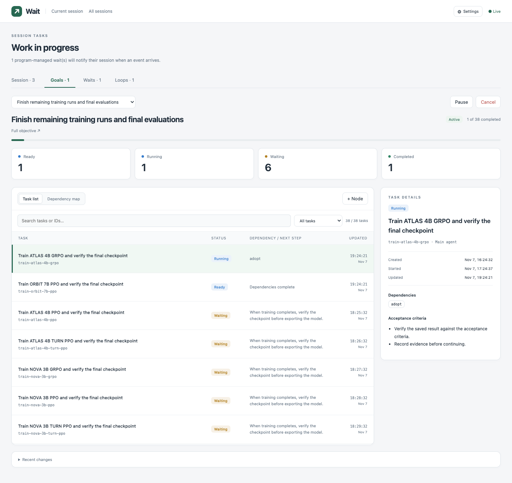
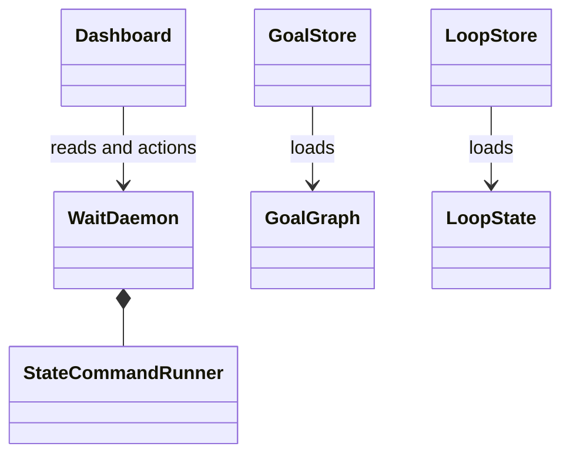

<p align="center">
  
</p>

<p align="center">
  <strong>等待事件，带着上下文继续。</strong><br>
  为 Agent 提供外部等待、有界循环与持久化任务图。
</p>

<p align="center">
  <a href="#安装">安装</a> · <a href="#用法">用法</a> · <a href="docs/dashboard.zh-CN.md">看板文档</a> · <a href="README.md">English</a>
</p>



<p align="center"><sub>示例任务 · 英文界面 · 浅色主题</sub></p>

## 安装

需要 Python 3.11 或更新版本。

```sh
git clone https://github.com/wenxueru/wait-skill.git /path/to/wait-skill
python /path/to/wait-skill/src/install_skill.py
```

- 默认安装到 `${CODEX_HOME:-~/.codex}/skills/wait`；其他客户端使用 `--destination /path/to/client/skills/wait`。
- 安装直接替换打包文件，删除旧嵌套 Skill 和匹配的 `wait-goal` / `wait-loop` 链接，不保留备份，也不修改其他同级目录。
- 安装后重新加载客户端。旧版 daemon 仍在运行时，先等 watcher 结束，再[停止并切换版本](docs/waitd.zh-CN.md#服务生命周期)。

## 用法

| 模式 | 适用场景 |
| --- | --- |
| [Wait](docs/wait.zh-CN.md) | 等待一次外部事件 |
| [Loop](docs/loop.zh-CN.md) | 在限定时长内重复检查或执行任务 |
| [Goal](docs/goal.zh-CN.md) | 按依赖推进任务，保留验收与恢复进度 |

```text
$wait 等待 deployment/api 进入 Ready；如果变成 Failed 就停止。

$wait loop 每 10 分钟检查 deployment/api，持续 2 小时，只报告变化。

$wait goal 发布 API。拆分实现和测试，测试及健康检查通过后完成。
```

等待期间由本地 `waitd` 检查状态、保存结果并投递事件；所属 Agent 收到事件后复查并继续。

## 看板

```sh
python ~/.codex/skills/wait/src/waitctl.py dashboard --session "$CODEX_THREAD_ID"
```

- 按会话查看等待、循环与目标，默认隐藏已结束记录。
- 多选状态、按耗时排序、查看依赖和循环历史。
- 默认英文、浅色；在「设置」中切换中文和深色。

任务命令也会返回所属会话的 `dashboard_url`。操作与远程访问见[看板文档](docs/dashboard.zh-CN.md)。

## 投递与安全

- Codex 使用 `$wait`，斜杠命令客户端使用 `/wait`。Claude Code 必须挂接原生后台 `follow` 任务；另有 CodeWiz、Cursor 和 GitHub Copilot 适配器，见[客户端设置](docs/clients.zh-CN.md)。
- Codex 恢复原 app-server 会话。`waitd` 应运行在该会话的主机上；只要两个服务均可用，Desktop 可以关闭。忙碌重试和不确定回执见[投递与恢复](docs/clients.zh-CN.md#桌面关闭与远程运行)。
- 等待程序应只读且有期限，凭据不得放入参数、状态、日志或通知。
- 程序输出和唤醒 note 不增加授权；验收结果或采取行动前，先复查当前状态。进程管理与恢复见[服务操作](docs/waitd.zh-CN.md)。

## 开发

Python 核心仅依赖标准库，浏览器依赖[随仓库本地打包](assets/vendor/README.md)；只有前端测试需要 Node。

| 位置 | 职责 |
| --- | --- |
| `src/` 入口 | CLI、安装脚本、等待程序 API 与共用子进程入口 |
| `src/wait/tasks/` | Goal、Loop 状态引擎 |
| `src/wait/service/` | watcher 监管与看板 HTTP 服务 |
| `src/wait/clients/` | 客户端投递适配器 |
| `src/wait/` 共享模块 | 运行逻辑、服务身份与回环地址策略 |
| `src/wait/dashboard/` | 共用任务视图、纯任务／导航模型、外观、交互控制器与本地图布局 |
| `agents/openai.yaml` | Skill 名称、图标、品牌色和默认提示词 |
| `tests/` | 按源码分层测试，`integration/` 覆盖跨进程流程和文档 |

```text
src/wait/
  dashboard/
    app.mjs          视图组合
    models/          状态、关系、链接
    controls/        筛选、会话、画布、帮助
    graph/           Dagre 布局
    styles.css       共用样式
assets/
  brand/             SVG 标志
  vendor/            本地依赖
```

`WaitDaemon` 持有命令执行器，`Dashboard` 向它查询和提交操作。JSON 类型归入 `tasks/schema.py`，不充当运行时继承基类。



在仓库根目录运行：

```sh
python -m unittest discover -s tests -t . -v
python -m unittest tests.tasks.test_goal -v
node --test tests/dashboard/*.test.mjs
python /path/to/skill-creator/scripts/quick_validate.py .
```

## 相关工作

`$wait goal` 是独立实现，没有复制以下项目的代码。直接影响实现的工作包括：

- [MACU](https://arxiv.org/abs/2606.01533)（[代码](https://github.com/kohjingyu/multi-agent-computer-use)）：中心调度、动态 DAG、受限并行派发和持久图历史。`$wait goal` 还处理跨轮次休眠和外部事件唤醒。
- [DynTaskMAS](https://arxiv.org/abs/2503.07675)：派发依赖已就绪的任务，按依赖范围传递上下文。`$wait goal` 的通信统一经根 Agent 中转。
- [Atomic Task Graph](https://arxiv.org/abs/2607.01942)：显式节点输入/产物契约、只追加事件和重试记录保留。

## 许可证

MIT。Dagre/Graphlib 的许可声明见 [assets/vendor/dagre.LICENSE.txt](assets/vendor/dagre.LICENSE.txt)。
