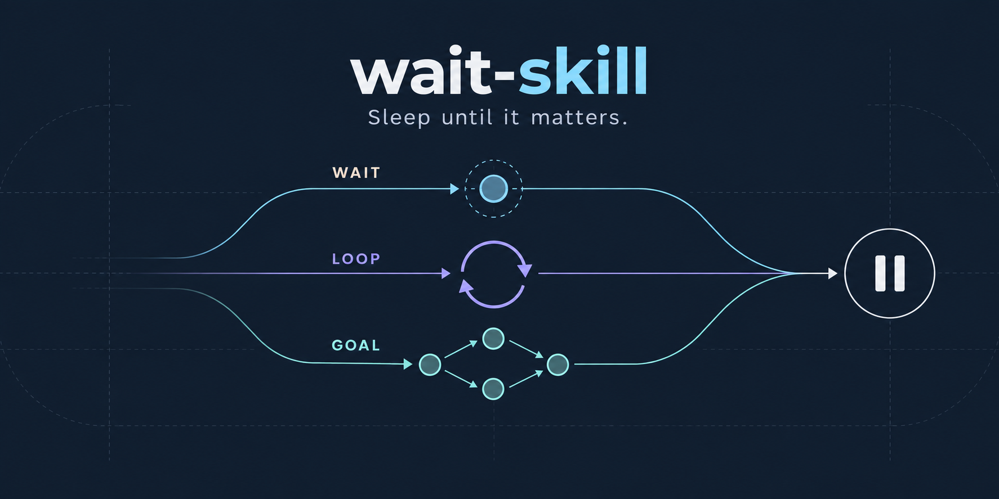

# wait-skill



[English](README.md) | 简体中文

一个事件驱动等待 Skill：程序在模型轮次之外等待，所属 Agent 被唤醒后验证结果。

| 调用 | 用途 | 协议 |
| --- | --- | --- |
| `$wait <条件>` | 等待一个外部状态 | [Wait](docs/wait.zh-CN.md) |
| `$wait loop <间隔>: <任务>` | 在有限总时长内重复执行 | [Loop](docs/wait-loop.zh-CN.md) |
| `$wait goal <目标>` | 执行并验收持久化任务依赖图 | [Goal](docs/wait-goal.zh-CN.md) |

斜杠命令客户端用 `/wait`。Codex 和 Claude Code 的投递见[客户端适配](docs/clients.zh-CN.md)；代码也保留 CodeWiz、Cursor 和 GitHub Copilot 的 CLI 适配。

## 安装

```bash
git clone https://github.com/wenxueru/wait-skill.git /path/to/wait-skill
python /path/to/wait-skill/src/install_skill.py
```

默认目标是 `${CODEX_HOME:-~/.codex}/skills/wait`，其他客户端用 `--destination /path/to/client/skills/wait`。安装直接替换打包文件，删除旧嵌套 Skill 和匹配的 `wait-goal` / `wait-loop` 链接，不保留旧版本备份，也不修改其他同级目录。安装后重新加载客户端。

已有状态路径和 event ID 保持有效，旧消息中的模式名按别名处理。若旧 daemon 仍在运行，先等其 watcher 结束，再[停止并切换版本](docs/waitd.zh-CN.md#服务生命周期)。

## 使用

```text
$wait 等待 deployment api 进入 Ready；Failed 时停止。
$wait loop 每 10 分钟检查队列，并报告需要处理的变化。
$wait goal 发布 API，仅在测试与健康检查通过后完成。
```

Codex 直接在原 app-server 启动轮次；只要执行主机上的该服务和 `waitd` 仍运行，Desktop 无需打开。[投递与恢复](docs/clients.zh-CN.md#桌面关闭与远程运行)说明限制、忙碌重试和不确定回执。Claude Code 必须挂接原生后台 `follow` 任务。

等待程序应只读且有有限期限。凭据不得进入参数、状态、日志或通知；程序输出与唤醒 note 都不增加授权，验收前由 Agent 复查当前状态。进程管理与恢复见[服务操作](docs/waitd.zh-CN.md)。

## 相关工作

`$wait goal` 是独立实现，没有复制以下项目的代码。这里只记录直接影响实现的工作：

| 工作 | 相关思想 | 与 `$wait goal` 的关系 |
| --- | --- | --- |
| [MACU](https://arxiv.org/abs/2606.01533)（[代码](https://github.com/kohjingyu/multi-agent-computer-use)） | Manager 构造和修改 DAG，并行派发 ready frontier，同时记录图快照和重新规划事件。 | 最接近的架构来源：中心调度、动态 DAG、受限 fan-out 和持久图历史。`$wait goal` 还专门处理跨轮次休眠和外部事件唤醒。 |
| [DynTaskMAS](https://arxiv.org/abs/2503.07675) | 异步执行引擎释放依赖已完成的任务，并选择性传递上下文。 | 启发了 ready frontier 调度和依赖范围内的节点输入。`$wait goal` 不允许子 Agent 直接共享上下文，所有信息仍经根 Agent 中转。 |
| [Atomic Task Graph](https://arxiv.org/abs/2607.01942) | 显式任务接口和图演化历史。 | 启发了节点输入/产物契约、只追加事件和重试记录保留。 |

## 开发

脚本只依赖 Python 标准库。

```bash
python -m unittest discover -s tests -v
python /path/to/skill-creator/scripts/quick_validate.py .
```

## 许可证

MIT
