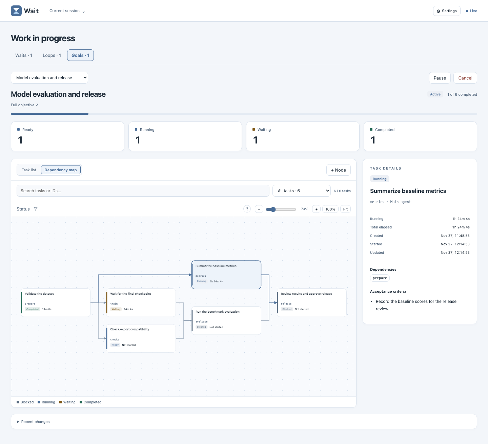
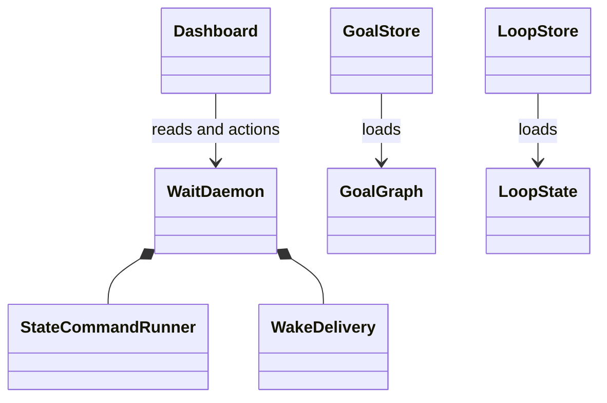

<p align="center">
  
</p>

<p align="center">
  <strong>等待事件，带着上下文继续。</strong><br>
  为 Agent 提供外部等待、有界循环与持久化任务图。
</p>

<p align="center">
  <a href="#安装">安装</a> · <a href="#用法">用法</a> · <a href="docs/dashboard.zh-CN.md">看板文档</a> · <a href="README.md">English</a>
</p>



<p align="center"><sub>示例任务 · 英文界面 · 浅色主题</sub></p>

## 安装

运行 `waitd` 的机器需要安装 Python 3.11 或更新版本和 pip。

### 从 skills.sh 安装

这个安装命令需要 Node.js。

```sh
npx skills add wenxueru/wait-skill --skill wait
```

开启新会话，让 Agent 设置 Wait，也可以手动完成下文的 [Python 设置](#python-设置)。

### 从 GitHub 安装

```sh
git clone https://github.com/wenxueru/wait-skill.git /path/to/wait-skill
python /path/to/wait-skill/src/install_skill.py
```

- 安装器把固定版本的 Python 库装到 skill 目录。运行 Wait 时使用安装时的 Python。
- 默认安装到 `${CODEX_HOME:-~/.codex}/skills/wait`；其他客户端使用 `--destination /path/to/client/skills/wait`。
- 安装直接替换打包文件，删除旧嵌套 Skill 和匹配的 `wait-goal` / `wait-loop` 链接，不保留备份，也不修改其他同级目录。
- 安装后重新加载客户端。旧版 daemon 仍在运行时，先等 watcher 结束，再[停止并切换版本](docs/waitd.zh-CN.md#服务生命周期)。

### Python 设置

从 Skill 管理器或插件目录安装后，在 macOS 或 Linux 上使用 Python 3.11 或更新版本。将 `WAIT_SKILL_DIR` 设为安装后包含 `SKILL.md` 的目录。

```sh
WAIT_SKILL_DIR=/path/to/installed/wait
python3 -m venv "$HOME/.cache/wait-skill/venv"
"$HOME/.cache/wait-skill/venv/bin/python" -m pip install -r "$WAIT_SKILL_DIR/src/requirements.txt"
```

使用这个环境的 Python 运行已安装的 `src/waitctl.py`。自动唤醒需要核对会话的 [Codex app-server 连接](docs/clients.zh-CN.md#codex)。

## 用法

| 模式 | 适用场景 |
| --- | --- |
| [Wait](docs/wait.zh-CN.md) | 等待一次外部事件 |
| [Loop](docs/loop.zh-CN.md) | 在限定时长内重复检查或执行任务 |
| [Goal](docs/goal.zh-CN.md) | 按依赖推进任务，保留验收与恢复进度 |

```text
$wait 等待 deployment/api 进入 Ready；如果变成 Failed 就停止。

$wait loop 每 10 分钟检查 deployment/api，持续 2 小时，只报告变化。

$wait goal 发布 API。拆分实现和测试，测试及健康检查通过后完成。
```

等待期间由本地 `waitd` 检查状态、保存结果并投递事件；所属 Agent 收到事件后复查并继续。

## 看板

请使用与安装方式对应的 Python 解释器和 Skill 路径。通过 GitHub 按默认路径安装时，在所属会话中运行下面的命令。

```sh
python ~/.codex/skills/wait/src/waitctl.py dashboard --session "$CODEX_THREAD_ID"
```

- 从会话摘要直达待处理任务。已完成和已取消的任务在「历史」中查看。
- 多选状态、按耗时排序、查看依赖和循环历史。
- 在「设置」中切换语言或主题，默认英文、浅色。

任务命令也会返回所属会话的 `dashboard_url`。操作与远程访问见[看板文档](docs/dashboard.zh-CN.md)。

## 事件投递

- **Codex** 唤醒原 app-server 会话。端点离线时保留已保存的事件，同一端点恢复后继续投递。见 [Codex 投递说明](docs/clients.zh-CN.md#投递与恢复)。
- **Claude Code** 在所属会话中用原生后台任务运行 `follow`。见 [Claude Code 配置](docs/clients.zh-CN.md#claude-code)。

等待程序应只读且有截止时间，凭据放在环境变量中。所属 Agent 收到事件后，先核对结果和当前状态，再接着做。

## 开发

`aiohttp` 提供看板服务，`websockets` 负责 Codex RPC 传输。浏览器加载[随仓库打包的模块](assets/vendor/README.md)。开发前端需要 Node.js。

| 位置 | 职责 |
| --- | --- |
| `src/` 入口 | CLI、安装脚本、等待程序 API 与共用子进程入口 |
| `src/wait/tasks/` | Goal、Loop 状态引擎 |
| `src/wait/service/` | watcher 监管、唤醒投递与看板 HTTP 服务 |
| `src/wait/clients/` | 客户端投递适配器 |
| `src/wait/` 共享模块 | 运行逻辑、服务身份与回环地址策略 |
| `src/wait/dashboard/` | 共用任务视图、纯任务／导航模型、外观、交互控制器与本地图布局 |
| `agents/openai.yaml` | Skill 名称、图标、品牌色和默认提示词 |
| `tests/` | 按源码分层测试，`integration/` 覆盖跨进程流程和文档 |

```text
src/wait/
  dashboard/
    app.mjs          视图组合
    models/          状态、关系、链接
    controls/        筛选、会话、画布、帮助
    graph/           Dagre 布局
    styles.css       共用样式
assets/
  brand/             SVG 标志
  vendor/            本地依赖
```

`WaitDaemon` 管理等待任务并保存状态，`WakeDelivery` 负责发送唤醒、重试和记录回执。看板通过服务读取和修改任务。Goal 的状态类型定义在 `tasks/schema.py`。



在开发环境里安装 Python 依赖，再从仓库根目录运行：

```sh
python -m pip install -r src/requirements.txt
python -m unittest discover -s tests -t . -v
npm test
python /path/to/skill-creator/scripts/quick_validate.py .
```

### 桌面插件打包

在仓库根目录运行 `python -m scripts.package_plugin`，桌面插件 ZIP 会生成在 `dist/` 下。

## 相关工作

`$wait goal` 是独立实现，没有复制以下项目的代码。直接影响实现的工作包括：

- [MACU](https://arxiv.org/abs/2606.01533)（[代码](https://github.com/kohjingyu/multi-agent-computer-use)）：中心调度、动态 DAG、受限并行派发和持久图历史。`$wait goal` 还处理跨轮次休眠和外部事件唤醒。
- [DynTaskMAS](https://arxiv.org/abs/2503.07675)：派发依赖已就绪的任务，按依赖范围传递上下文。`$wait goal` 的通信统一经根 Agent 中转。
- [Atomic Task Graph](https://arxiv.org/abs/2607.01942)：显式节点输入/产物契约、只追加事件和重试记录保留。

## 许可证

MIT。见[随附依赖的许可声明](assets/vendor/README.md)。
