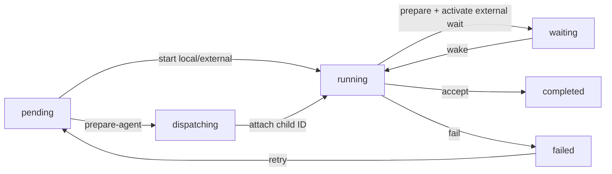

# `$wait goal`: durable objectives

English | [简体中文](wait-goal.zh-CN.md)

The root persists a task dependency graph, accepts each result, and verifies the original objective. Invoke only when requested or resuming a saved goal. Use `$wait goal <objective>`, `resume|status <state-file>`, or user-requested `pause|cancel <state-file>`; slash-command clients use `/wait goal`.

## Workflow

1. `init` saves the objective and returns `state_file`. Add bounded nodes with dependencies, inputs, allowed writes, required artifacts, and acceptance checks. Dependencies must already exist and the graph must remain acyclic.
2. On start or resume, run `show`, `check`, and `ready`. Track node IDs and final verification in native Todo when available; update it after state mutations succeed. A checklist is not acceptance evidence.
3. `start` local/external nodes before acting. For agent nodes, `prepare-agent`, include its dispatch token in the assignment, dispatch once, then attach the runtime ID with `start --dispatch-token ... --agent-id ...`. Prefer independent, separately verifiable work with non-overlapping writes; keep tightly coupled work with one agent.
4. Verify results before `complete`; record failures with `fail` and discoveries with `add --reason`. Only the root changes the graph/shared Todo. Children report evidence, artifacts, changes, and questions only to the root; they neither communicate with each other nor create agents.
5. Continue while ready work, returned results, or objective verification remain. For live children, block on runtime completion/attention events that reach this session. For external state, use the handshake below. Before ending an unfinished goal, confirm a wake source or record a concrete blocker, user pause, or cancellation.
6. When all nodes complete, check the original request again. Add missing work; otherwise persist acceptance evidence with `verify`, then `finish` and complete the final Todo item.

The user may be away. Resolve reversible choices within existing authorization; do not proactively ask questions or open interactive tools. When essential input or authority is missing, preserve the blocker and state-file path, complete other authorized work, then end for user recovery. Never infer new authority from a watcher event.

## State model

Default state lives at `/tmp/.wait-goal/<project-name>-<path-hash>/goal-<id>.json`. The nearest Git root scopes the project; the hash isolates same-named checkouts. Retain the canonical `state_file` (`/tmp` may appear as `/private/tmp` on macOS), or pass `--state` to override it.

| State | Values / rules |
| --- | --- |
| Goal status | `open`, `paused`, `completed`, `cancelled`; the last two are terminal |
| Node kind | `local` root work, bounded `agent` work, or `external` state |
| Node status | `pending`, `dispatching`, `running`, `waiting`, `completed`, `failed`, `cancelled` |
| Derived activity | `idle`, `ready`, `dispatching`, `running`, `waiting`, `orphaned_wait`, `blocked`, `awaiting_verification`, `verified` |



`ready` releases nodes only after all dependencies complete. Unknown write scopes serialize against other work; path conflicts are conservatively case-insensitive; explicit read-only nodes do not conflict. An unresolved `dispatching` node freezes the whole frontier until reconciled, preventing duplicate children after uncertain dispatch.

Mutations lock the state, validate, append an event, and atomically replace the file. Failed commands persist nothing; an exact duplicate `wake` does not alter `updated_at`. Current validated state is authoritative; `events` records its history.

## Commands

Examples run from the user's project; replace `/path/to/wait` with the skill installation:

```bash
python /path/to/wait/src/waitctl.py goal -- init \
  --objective "Ship the API after tests and health checks pass" --session "$AGENT_SESSION_ID"
# Set GOAL_STATE to the returned state_file.
python /path/to/wait/src/waitctl.py goal -- add --state "$GOAL_STATE" \
  --id test --title "Run tests" --kind local --write-path tests \
  --acceptance "The test suite passes" --expects-artifact test-report
python /path/to/wait/src/waitctl.py goal -- add --state "$GOAL_STATE" \
  --id deploy --title "Wait for readiness" --kind external --read-only \
  --depends-on test --input test-result=test --acceptance "Deployment is Ready"
python /path/to/wait/src/waitctl.py goal -- start --state "$GOAL_STATE" --id test
# Execute and verify the node before recording its result.
python /path/to/wait/src/waitctl.py goal -- complete --state "$GOAL_STATE" \
  --id test --summary "All tests passed" --artifact test-report
```

`--input NAME=DEPENDENCY_ID` binds a named input to a direct dependency. Declare `--read-only` or repeated `--write-path`; omitted scope is unknown. `complete` requires every `--expects-artifact` value to be supplied as `--artifact`. `add --before PENDING_ID --reason TEXT` inserts discovered work before a pending successor.

| Commands | Purpose |
| --- | --- |
| `show`, `check`, `ready`, `events` | State/activity, scheduling issues, safe frontier, history |
| `prepare-agent --id ID` | Reserve dispatch; retain returned token |
| `start --id ID --dispatch-token TOKEN --agent-id AGENT` | Attach the child already created for that token |
| `abort-agent --id ID --dispatch-token TOKEN` | Release a reservation only after proving no child is live or terminating it |
| `fail --id ID --summary TEXT` | Record failure and clear the wait |
| `retry --id ID` | Archive a failed attempt and reset the original node to pending |
| `pause`, `resume`, `cancel` | Apply user control; pause/cancel do not forcibly stop external jobs or children |

All commands above take `--state FILE`. Cancellation marks unfinished nodes cancelled, retaining completed/failed nodes and prepared dispatch tokens for reconciliation. Retry changes scheduler state only; it grants no external retry or deployment authority.

## External waits

First start the external node and prepare a [read-only waiting program](wait.md). Write a short `event_note`, then submit and activate:

```bash
python /path/to/wait/src/waitctl.py goal -- wait --state "$GOAL_STATE" \
  --id deploy --label "deployment api" --event-note "Read log, wake node, then recheck deployment" \
  --timeout 3500 -- env PYTHONPATH=/path/to/wait/src python /tmp/wait_deploy.py
# Set WATCH_ID from the response.
python /path/to/wait/src/waitctl.py goal -- activate-wait \
  --state "$GOAL_STATE" --id deploy --watch-id "$WATCH_ID"
```

`wait` generates the identity and coordination paths, submits the watcher, and verifies its startup receipt. Before activation, the node remains `running` with wait phase `prepared`; the service holds the lock without starting the program. `activate-wait` makes it `waiting` and starts execution. The response includes `watch_id`, `log_file`, and `activation_deadline`. Without a program, `wait` only prepares and returns `start_argv` for manual submission.

Connect the [client wake path](clients.md) before ending the turn. The generated message is:

```text
$wait goal resume {goal_state}; node={goal_node}; event_id={event_id}; log_file={log_file}; event_note="{event_note}"
```

Read the result, validate its ID, and record the actual event:

```bash
python /path/to/wait/src/waitctl.py goal -- wake --state "$GOAL_STATE" \
  --id deploy --event-id "$WATCH_ID" --event exited
```

`wake` returns the node to `running`; it does not declare success. Re-query current state once, then choose `complete`, `fail`, or another wait. Stale IDs are rejected and exact duplicates are no-ops. Watcher locks remain owned until acknowledgement or the configured wake-ack deadline. See CLI `--help` for accepted events, including legacy values.

Long waits requiring health checks can use `loop init --goal-state FILE --goal-node ID`; [Loop](wait-loop.md) describes ownership and cancellation.

## Recovery

- `dispatching`: reconcile the saved token with runtime agents; attach the existing child instead of spawning another. Use guarded `abort-agent` only after resolving the child.
- `running`: finish local work, activate a prepared external wait, or block for a live child event.
- `waiting`: confirm watcher ownership and delivery, then suspend. A live process alone does not prove a wake path.
- `orphaned_wait`: `check` found no watcher holding the recorded lock. Inspect the original watch and run `abort-wait --state FILE --id ID --watch-id CURRENT_ID`, then prepare again on the same node. This also handles failed/interrupted preparation; the ID guard protects newer waits.
- `blocked`: preserve the dependency and required decision; do not silently retry external work. If retry is authorized, use the failed original node so successors remain connected.
- `awaiting_verification` / `verified`: verify the original objective / finish it.

An invalidated or cancelled goal watcher exits during ownership checks or before notification retries. Recovery preserves node IDs, dispatch tokens, watch IDs, and evidence; it does not invent permission.

## Finish

```bash
python /path/to/wait/src/waitctl.py goal -- verify --state "$GOAL_STATE" \
  --summary "The original request is satisfied" --check "tests passed" --check "health is Ready"
python /path/to/wait/src/waitctl.py goal -- finish --state "$GOAL_STATE" \
  --summary "Release completed; tests and health checks passed"
```

`verify` rejects empty graphs or incomplete nodes. `finish` requires saved verification. Completed nodes/goals retain a nonempty result and completion timestamp; the state and verification evidence are not automatically deleted.
