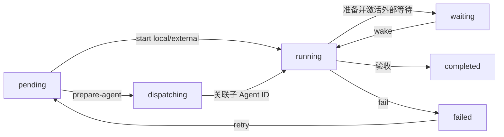

# `$wait goal`：持久目标

[English](wait-goal.md) | 简体中文

根 Agent 保存任务依赖图、验收各项结果并验证原始目标。仅在用户请求或恢复已有目标时进入。用 `$wait goal <目标>`、`status <状态文件>`，以及用户要求的 `pause|cancel <状态文件>`；斜杠客户端对应 `/wait goal`。

## 流程

1. `init` 保存目标并返回 `state_file`。节点应是有界任务，写清依赖、输入、允许修改的范围、必需产物和验收条件。依赖先于节点存在，图必须无环。
2. 每次启动或恢复运行 `show`、`check`、`ready`。有原生 Todo 时按节点 ID 和最终验收跟踪，状态变更成功后再同步；清单不等于验收证据。
3. local/external 节点先 `start` 再执行；agent 节点先 `prepare-agent`，把 dispatch token 带进任务，只派发一次，再用 `start --dispatch-token ... --agent-id ...` 关联实例。独立、可分别验收且写入不冲突的工作可并发，紧密耦合的工作交给一个 Agent。
4. 验证结果后 `complete`；失败用 `fail`，新发现用 `add --reason`。只有根 Agent 修改图和共享 Todo；子 Agent 只向根汇报证据、产物、改动和疑问，不互相联系，也不创建 Agent。
5. 还有就绪任务、返回结果或目标待验收时继续推进。等存活子 Agent 时使用能将完成／异常事件送回当前会话的运行时阻塞等待；等外部状态时用下面的握手。结束未完成目标前，必须确认唤醒来源，或记录具体阻塞、用户暂停或取消。
6. 节点全部完成后重新核对原始请求，缺工作就补节点；达成后用 `verify` 保存证据，再 `finish` 并完成最终 Todo。

用户可能不在场。已有授权内的可逆选择自行判断，不主动提问或打开交互工具；缺少关键输入或权限时保留原因与状态路径，先做其他已授权工作，再结束等待用户恢复。watcher 事件不增加授权。

## 状态模型

默认状态位于 `/tmp/.wait-goal/<项目名>-<路径哈希>/goal-<ID>.json`。最近的 Git 根目录确定项目，哈希隔离同名 checkout。保留规范化 `state_file`（macOS 的 `/tmp` 可能显示为 `/private/tmp`），或用 `--state` 覆盖。

| 状态 | 取值／规则 |
| --- | --- |
| Goal 状态 | `open`、`paused`、`completed`、`cancelled`；后两者是终态 |
| 节点类型 | 根执行的 `local`、有界委派的 `agent`、外部状态 `external` |
| 节点状态 | `pending`、`dispatching`、`running`、`waiting`、`completed`、`failed`、`cancelled` |
| 派生活动 | `idle`、`ready`、`dispatching`、`running`、`waiting`、`orphaned_wait`、`blocked`、`awaiting_verification`、`verified` |



`ready` 只释放依赖全部完成的节点。未知写入范围与其他工作串行，路径冲突保守地忽略大小写，显式只读节点不冲突。未解决的 `dispatching` 会冻结整个就绪队列，避免派发结果不确定后重复创建子 Agent。

状态修改在锁内校验、追加事件并原子替换文件。失败命令不落盘；完全重复的 `wake` 不修改 `updated_at`。当前有效状态是恢复依据，`events` 保留其历史。

## 命令

在用户项目中执行，`/path/to/wait` 替换为 Skill 安装目录：

```bash
python /path/to/wait/src/waitctl.py goal -- init \
  --objective "发布 API，并通过测试与健康检查" --session "$AGENT_SESSION_ID"
# GOAL_STATE 使用返回的 state_file。
python /path/to/wait/src/waitctl.py goal -- add --state "$GOAL_STATE" \
  --id test --title "运行测试" --kind local --write-path tests \
  --acceptance "测试通过" --expects-artifact test-report
python /path/to/wait/src/waitctl.py goal -- add --state "$GOAL_STATE" \
  --id deploy --title "等待部署就绪" --kind external --read-only \
  --depends-on test --input test-result=test --acceptance "部署为 Ready"
python /path/to/wait/src/waitctl.py goal -- start --state "$GOAL_STATE" --id test
# 执行并验收节点后，再记录结果。
python /path/to/wait/src/waitctl.py goal -- complete --state "$GOAL_STATE" \
  --id test --summary "全部测试通过" --artifact test-report
```

`--input NAME=DEPENDENCY_ID` 将具名输入绑定到直接依赖。声明 `--read-only` 或多个 `--write-path`，省略时视为未知范围。每个 `--expects-artifact` 都必须由 `complete --artifact` 提供。`add --before PENDING_ID --reason TEXT` 可把新发现的工作插入待执行后继之前。

| 命令 | 用途 |
| --- | --- |
| `show`、`check`、`ready`、`events` | 状态／活动、调度问题、安全就绪队列、历史 |
| `prepare-agent --id ID` | 预留派发，保留返回的 token |
| `start --id ID --dispatch-token TOKEN --agent-id AGENT` | 关联该 token 已创建的子 Agent |
| `abort-agent --id ID --dispatch-token TOKEN` | 仅在确认没有存活子 Agent 或已终止后释放预留 |
| `fail --id ID --summary TEXT` | 记录失败并清除等待 |
| `retry --id ID` | 归档失败尝试，将原节点重置为 pending |
| `pause`、`resume`、`cancel` | 应用用户控制；暂停／取消不强行停止外部任务或子 Agent |

上述命令均接收 `--state FILE`。取消会把未完成节点标为 cancelled，保留 completed/failed 节点及派发中的 token 供核对。Retry 只改调度状态，不授予外部重试或部署权限。

## 外部等待

先启动 external 节点并准备[只读等待程序](wait.zh-CN.md)。写 `event_note` 描述下一步，再提交和激活：

```bash
python /path/to/wait/src/waitctl.py goal -- wait --state "$GOAL_STATE" \
  --id deploy --label "deployment api" --event-note "读取日志，wake 节点，再复查部署" \
  --timeout 3500 -- env PYTHONPATH=/path/to/wait/src python /tmp/wait_deploy.py
# WATCH_ID 使用响应返回值。
python /path/to/wait/src/waitctl.py goal -- activate-wait \
  --state "$GOAL_STATE" --id deploy --watch-id "$WATCH_ID"
```

`wait` 生成标识与协调路径、提交 watcher 并验证启动回执。激活前节点仍为 `running`、wait phase 为 `prepared`；服务持锁但不启动程序。`activate-wait` 将其变成 `waiting` 并启动程序。响应含 `watch_id`、`log_file` 和 `activation_deadline`。不附程序时，`wait` 只准备，并返回手动提交用的 `start_argv`。

结束轮次前按[客户端适配](clients.zh-CN.md)接好唤醒。生成的消息为：

```text
$wait goal resume {short_id} — {event_note}
```

先按[唤醒恢复协议](../SKILL.zh-CN.md#唤醒消息)解析短 ID，再执行本模式的恢复步骤。

读取结果、校验 ID，再记录实际事件：

```bash
python /path/to/wait/src/waitctl.py goal -- wake --state "$GOAL_STATE" \
  --id deploy --event-id "$WATCH_ID" --event exited
```

`wake` 只让节点回到 `running`，不宣告成功。只读复查一次当前状态，再决定 `complete`、`fail` 或继续等待。旧 ID 被拒绝，完全重复事件为空操作。Watcher 锁保留到确认或配置的 wake-ack 截止时间。可接受事件（含旧版值）见 CLI `--help`。

长等待需要健康检查时可用 `loop init --goal-state FILE --goal-node ID`；所有权与取消规则见 [Loop](wait-loop.zh-CN.md)。

## 恢复

- `dispatching`：用保存的 token 核对运行时，关联已创建的子 Agent，不再派发；解决子 Agent 后才能使用带 token 的 `abort-agent`。
- `running`：完成本地工作、激活准备好的外部等待，或阻塞等待存活子 Agent 的事件。
- `waiting`：确认 watcher 所有权与投递路径，再休眠；仅有存活进程不证明能唤醒。
- `orphaned_wait`：`check` 发现没有 watcher 持有记录的锁。检查原 watch，运行 `abort-wait --state FILE --id ID --watch-id CURRENT_ID`，再在原节点准备。准备失败／中断也用此流程；ID 校验防止取消较新的等待。
- `blocked`：保留阻塞依赖与所需决定，不静默重试外部操作。获得重试授权后用原失败节点，保留后继依赖。
- `awaiting_verification` / `verified`：验证原始目标／完成目标。

等待失效或 Goal 被取消时，原 watcher 会在所有权检查或通知重试前退出。恢复保留节点 ID、dispatch token、watch ID 和证据，不猜测权限。

## 完成

```bash
python /path/to/wait/src/waitctl.py goal -- verify --state "$GOAL_STATE" \
  --summary "原始请求已满足" --check "测试通过" --check "健康状态为 Ready"
python /path/to/wait/src/waitctl.py goal -- finish --state "$GOAL_STATE" \
  --summary "发布完成，测试与健康检查通过"
```

`verify` 拒绝空图或未完成节点，`finish` 要求已保存验证。完成节点／目标必须保留非空结果与完成时间；状态和验证证据不会自动删除。
